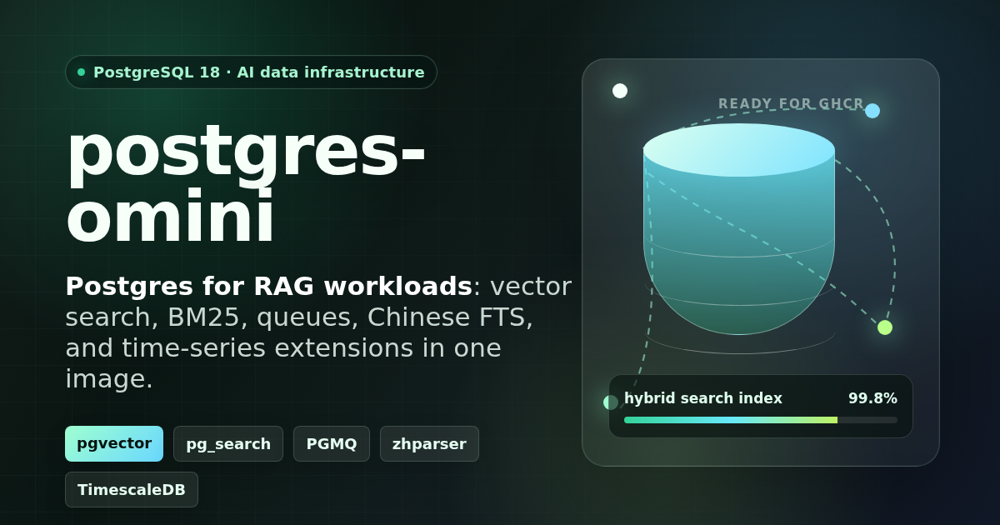

<p align="center">
  
</p>

# postgres-omini

PostgreSQL 18 on Debian trixie, with vector search, BM25 and Chinese full-text search, message queues, and time-series extensions. A new data volume automatically enables the five extensions in the default database.

| Component | Default version | Purpose |
| --- | --- | --- |
| PostgreSQL | 18, from `postgres:18-trixie` | Database server |
| pgvector | 0.8.4 | Vector similarity search and HNSW indexes |
| ParadeDB pg_search | 0.24.1 | BM25 relevance and Jieba/Lindera/CJK tokenizers |
| PGMQ | 1.11.1 | PostgreSQL-native message queues |
| TimescaleDB | 2.28.2 | Hypertables and continuous aggregates; full build including TSL |
| zhparser | 2.3 | Native PostgreSQL Chinese text search |
| SCWS | 1.2.3 | Segmentation library used by zhparser |

The default database is `postgres`. Extensions are database-local: existing data volumes and databases created later need explicit setup. See [operations and upgrades](docs/operations.md).

## Quick start

```bash
cp .env.example .env
# Edit .env and set POSTGRES_PASSWORD to a unique, non-empty password.
docker compose up -d --build --wait --wait-timeout 180
psql -h 127.0.0.1 -p 5432 -U postgres -d postgres -W
```

Requires Docker with the Compose v2 plugin. Compose refuses to start without a password and publishes port 5432 on `127.0.0.1`. Set `PGHOST_PORT` in `.env` to use a different port; `POSTGRES_HOST_IP` explicitly changes the bind address when remote access is needed. `.env` is excluded from Git and the image build context.

The named volume mounts `/var/lib/postgresql`, matching the PostgreSQL 18 image's `PGDATA=/var/lib/postgresql/18/docker`. **If you used an older revision of this Compose file, inspect and back up the actual data location before recreating containers. Changing a mount path does not migrate existing data.** Follow the [old-volume migration notes](docs/operations.md#existing-volumes-and-the-pg18-mount-fix).

The health check makes a TCP SQL connection and checks all five extensions and `public.chinese`. It becomes ready after the entrypoint finishes initialization. Check the installed versions with:

```sql
SELECT extname, extversion
FROM pg_extension
WHERE extname IN ('vector', 'pg_search', 'timescaledb', 'pgmq', 'zhparser')
ORDER BY extname;
```

Chinese search options:

```sql
-- Native PostgreSQL FTS with zhparser.
SELECT to_tsvector('public.chinese', '中文分词用于全文检索');

-- ParadeDB BM25 with Jieba tokenizer.
CREATE TABLE cn_docs (id bigserial PRIMARY KEY, body text NOT NULL);
INSERT INTO cn_docs (body) VALUES ('PostgreSQL 中文分词和向量搜索开箱即用');
CREATE INDEX cn_docs_search_idx ON cn_docs
USING bm25 (id, (body::pdb.jieba))
WITH (key_field='id');
SELECT id, pdb.score(id)
FROM cn_docs
WHERE body @@@ '中文搜索'
ORDER BY pdb.score(id) DESC;
```

TimescaleDB example:

```sql
CREATE TABLE metrics (
  time timestamptz NOT NULL,
  device text NOT NULL,
  value double precision NOT NULL
);
SELECT create_hypertable('metrics', 'time');
INSERT INTO metrics (time, device, value)
SELECT now() - (i * interval '1 minute'), 'dev-' || (i % 10), random() * 100
FROM generate_series(1, 1000) AS i;
SELECT time_bucket('5 minutes', time) AS bucket, avg(value)
FROM metrics
GROUP BY bucket
ORDER BY bucket DESC;
```

## Build

```bash
docker build -t postgres-omini:local .
```

The build compiles pgvector, PGMQ, SCWS, zhparser, and TimescaleDB from fixed upstream release tags, and installs the matching ParadeDB Debian package. It supports **PostgreSQL 18 with Debian trixie**; incompatible PostgreSQL or Debian overrides fail explicitly. pgvector is built without `-march=native` so it does not inherit the build runner's CPU instruction set.

CI builds, tests, and publishes **`linux/amd64`**. The Dockerfile selects the ParadeDB package from BuildKit's target architecture and validates it against the base image. ARM64 source builds are not covered by the current CI or published as a supported image.

The base tag receives PostgreSQL 18 patch updates. Inspect the actual server version and bundled component manifest for each built image:

```bash
docker run --rm --entrypoint cat postgres-omini:local \
  /usr/share/doc/postgres-omini/components.tsv
```

If your network needs a proxy or a local Debian mirror:

```bash
docker build \
  --build-arg APT_MIRROR=https://mirrors.example.org/debian \
  --build-arg FETCH_HTTP_PROXY=http://proxy.example.org:3128 \
  --build-arg FETCH_HTTPS_PROXY=http://proxy.example.org:3128 \
  -t postgres-omini:local .
```

Replace those example addresses with your own. The fetch proxy arguments apply to extension downloads; configure your Docker daemon separately if it needs a proxy to pull base images.

## Runtime validation

```bash
docker build -t postgres-omini:local .
POSTGRES_OMINI_IMAGE=postgres-omini:local ./scripts/smoke-test.sh
```

The smoke test uses the actual Compose file with an isolated project, a random password, and an automatically allocated localhost port. It checks:

- First initialization, extension versions, and the shared health check.
- Known vector/HNSW results, BM25 relevance order, Jieba, and zhparser/GIN matches.
- PGMQ send, read, visibility timeout, retry, archive, delete, and batch pop semantics.
- TimescaleDB hypertables and two continuous-aggregate refreshes with exact expected values.
- A complete container removal and recreation while retaining the same named volume, database identity, rows, and extension indexes.

The script removes its own temporary project and volumes on exit. It requires an image already built or pulled locally and never rebuilds or pulls a different image during the test. `SMOKE_TIMEOUT` controls the startup wait, in seconds (default `180`).

## Synthetic benchmark

```bash
./scripts/benchmark.sh

# Reuse an existing image instead of rebuilding it.
SKIP_BUILD=1 IMAGE=postgres-omini:local \
  ROWS=100000 REPEATS=5 WARMUP=1 ./scripts/benchmark.sh
```

`ROWS` defaults to `20000` and must be at least `100`. `REPEATS` defaults to `3`; `WARMUP` defaults to `1`. Set `CONTAINER` to choose another temporary container name. An existing container with that name causes a clear error and is never removed. The script works from any directory, publishes no host port, and removes its own container and anonymous data volumes.

Before timing, it asserts BM25 ranking and that a batch pop returns 100 distinct messages and actually removes 100 queue rows. Every queue timing rolls back to restore the same logical input state. Read queries run after `ANALYZE`, with warmup and repeated samples; the report shows median, minimum, and maximum milliseconds.

These are **synthetic smoke timings**. They include `docker exec`, client startup, connection setup, SQL execution, and, for queue cases, rollback. The 3D vectors are distinct synthetic points, not model embeddings. The report does not measure ANN recall, retrieval quality, sustained throughput, or production capacity.

Extra build flags can be supplied when `SKIP_BUILD=0`:

```bash
DOCKER_BUILD_ARGS="--build-arg FETCH_HTTPS_PROXY=http://proxy.example.org:3128" \
  ./scripts/benchmark.sh
```

This variable is split into whitespace-separated arguments; use a separate `docker build` followed by `SKIP_BUILD=1` for arguments containing spaces.

## Published image

Successful `main` builds publish to:

```text
ghcr.io/ider-zh/postgres-omini:latest
```

After configuring `.env`, use the published image without a local build:

```bash
export POSTGRES_OMINI_IMAGE=ghcr.io/ider-zh/postgres-omini:latest
docker compose pull postgres
docker compose up -d --no-build --wait --wait-timeout 180
```

`main` and `latest` are mutable tags. Each validated build also receives `sha-<full-commit-sha>`; version tags are published when a matching Git tag is pushed. Pin a validated image digest for deployments that must remain reproducible. The Actions artifacts record the image, component versions, test logs, and published digests.

The workflow loads the candidate image, runs the smoke test and a small benchmark, then pushes that exact local image. A failed build or test prevents publication. Pull requests run the same validation without publishing.

**Historical release correction:** `v18.4.1` points to commit `43889438` and does not contain TimescaleDB. TimescaleDB was added later in `ec5e3918`. The original release description was inaccurate; the historical Git tag is preserved. See [CHANGELOG.md](CHANGELOG.md).

## Licenses and operations

The image includes upstream license and notice files under `/usr/share/doc/postgres-omini/`, including the Timescale License for the full TimescaleDB build. See [THIRD_PARTY_NOTICES.md](THIRD_PARTY_NOTICES.md) for the component inventory and source links.

For backups, existing volumes, per-database setup, extension updates, and PostgreSQL major upgrades, read [docs/operations.md](docs/operations.md).

